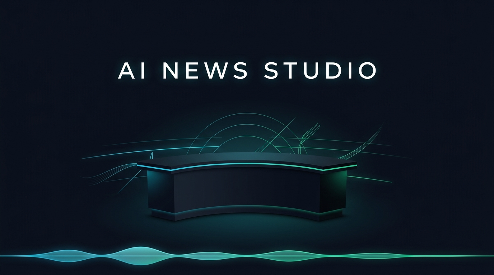
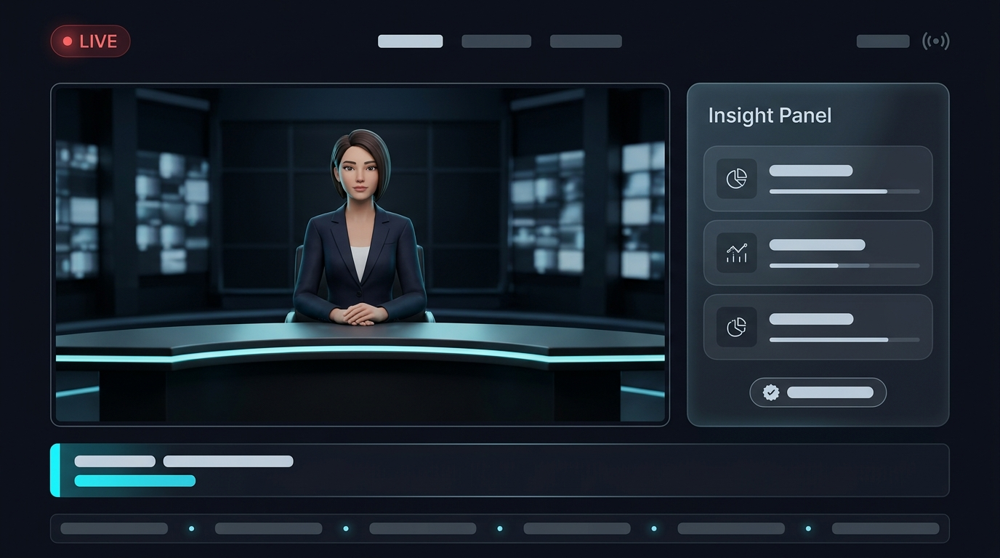
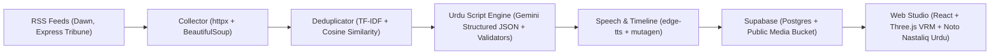

<div align="center">



# AI News Studio

**Automated Urdu AI Broadcast Pipeline and 3D Virtual Studio Player**

[](https://www.python.org/)
[](https://fastapi.tiangolo.com/)
[](https://ai.google.dev/)
[](https://scikit-learn.org/)
[](https://supabase.com/)
[](https://react.dev/)
[](https://www.typescriptlang.org/)
[](https://tailwindcss.com/)
[](https://threejs.org/)
[](https://github.com/features/actions)

</div>

---

## Overview

**AI News Studio** is a zero-budget, simulated television newsroom designed for a Pakistani Urdu audience. It ingests verified reporting from Pakistani RSS feeds, removes duplicate coverage across publishers, generates source-grounded Urdu anchor scripts, synthesizes neural speech with exact audio timelines, and presents synchronized bulletins inside a browser-based 3D studio player.

It is an automated broadcast simulation system built on open-source and free-tier tooling, not a live TV channel or GPU video generator.

### Conceptual Studio Interface Preview

<div align="center">
  
</div>

*Target studio layout: 3D VRM news anchor with audio-driven lip sync, synchronized Urdu insight panel, lower-third headline card, and right-to-left breaking news ticker.*

---

## Architecture



### Key Engineering Guarantees

| Component | Design Choice | Purpose |
| :--- | :--- | :--- |
| **Ingestion & Clustering** | `httpx` + `feedparser` + `TfidfVectorizer` | Merges duplicate Dawn and Express Tribune coverage with graceful summary fallback |
| **Grounded Script Engine** | `google-genai` structured JSON + custom validators | Enforces 35-60 Urdu words, >= 80% Urdu script ratio, 3 insight facts, and zero invented numbers/entities |
| **Speech & Timeline** | `TTSProvider` (`edge-tts`) + `mutagen` | Measures exact MP3 durations and computes cumulative `start_time_sec` with a 0.6s gap |
| **Data & Security** | Supabase Postgres (RLS) + `local_json` fallback | Public `anon` read-only access to `ready` bulletins; backend writes isolated via secret key |
| **3D Studio Player** | Three.js + `@pixiv/three-vrm` + Web Audio API | Real-time loudness-driven mouth expressions in the browser with zero GPU server cost |

---

## Tech Stack

| Layer | Technologies |
| :--- | :--- |
| **Backend & API** |    |
| **NLP & LLM** |   |
| **Speech & Audio** | `edge-tts` (`ur-PK-UzmaNeural`, `ur-PK-AsadNeural`), `mutagen` |
| **Database & Storage** |  |
| **Frontend Studio** |      `Noto Nastaliq Urdu` |
| **Testing & Automation** |  `ruff` `vitest`   |

---

## Module Status

| Module | Status | Notes |
| :--- | :--- | :--- |
| RSS Collector & TF-IDF Deduplicator | Implemented | Dawn and Express Tribune feeds with 10s timeout and fallback |
| Supabase Schema, RLS & Media Client | Implemented | Migrations, public `media` upload, pruning, and offline JSON fallback |
| Gemini Urdu Script Engine & Validators | Implemented | Single-call generation, retry on failed story, and `sample_bulletin_ur.json` backup |
| Urdu TTS Engine & Timeline Sync | Implemented | `TTSProvider` abstraction, abbreviation cleanup, `mutagen` timing, and Supabase upload |
| End-to-End Batch Job & Cron Automation | Planned | Single-command pipeline runner and scheduled GitHub Actions workflow |
| React Studio Player & 3D VRM Anchor | Planned | RTL Nastaleeq UI, synchronized timeline player, and Web Audio lip-sync |

---

## Repository Structure

```text
├── .github/workflows/          # CI checks (and scheduled pipeline workflow)
├── backend/
│   ├── app/
│   │   ├── core/config.py      # Pydantic settings loaded from backend/.env
│   │   ├── eval/               # Validator pass-rate evaluation scripts
│   │   ├── pipeline/           # Collector, deduplicator, prompts, validators, Gemini, TTS, timeline
│   │   ├── schemas/            # Pydantic data contracts
│   │   ├── services/           # Supabase Postgres/Storage client and health check
│   │   └── main.py             # FastAPI server
│   ├── data/                   # Saved sample Urdu bulletin for offline demo fallback
│   ├── supabase/migrations/    # Postgres tables, indexes, RLS policies, and grants
│   ├── tests/                  # Offline pytest suite
│   ├── requirements.txt
│   └── .env.example
├── docs/assets/                # Repository visuals
└── frontend/                   # React + TypeScript + Three.js studio (upcoming)
```

---

## Run Locally

Run all commands from the repository root.

### Windows (PowerShell)
```powershell
python -m venv .venv
.\.venv\Scripts\Activate.ps1
pip install -r backend\requirements.txt
copy backend\.env.example backend\.env
# Fill in SUPABASE_URL, SUPABASE_SERVICE_ROLE_KEY, GEMINI_API_KEY, and GEMINI_MODEL

pytest
python -m backend.app.pipeline.collector
python -m backend.app.pipeline.check_gemini
python -m backend.app.services.check_supabase
uvicorn backend.app.main:app --reload
```

### Mac / Linux
```bash
python3 -m venv .venv
source .venv/bin/activate
pip install -r backend/requirements.txt
cp backend/.env.example backend/.env
# Fill in SUPABASE_URL, SUPABASE_SERVICE_ROLE_KEY, GEMINI_API_KEY, and GEMINI_MODEL

pytest
python -m backend.app.pipeline.collector
python -m backend.app.pipeline.check_gemini
python -m backend.app.services.check_supabase
uvicorn backend.app.main:app --reload
```

Once the server starts, open `http://localhost:8000/docs` in your browser.

---

## Limitations & Academic Disclaimer

- **Unofficial TTS endpoint:** `edge-tts` relies on Microsoft Edge's online speech service and can experience transient failures; retry logic and the `TTSProvider` interface are in place to support swapping to Azure Speech if needed.
- **Simulated lip sync:** Mouth movement uses Web Audio loudness (`AnalyserNode`) driving VRM blendshapes rather than phoneme-level alignment or GPU face rendering.
- **Source attribution:** All ingested articles remain attributed to their original publishers (`Dawn` and `The Express Tribune`) with direct source URLs. This software is an academic research prototype and does not operate as a licensed broadcast service.
